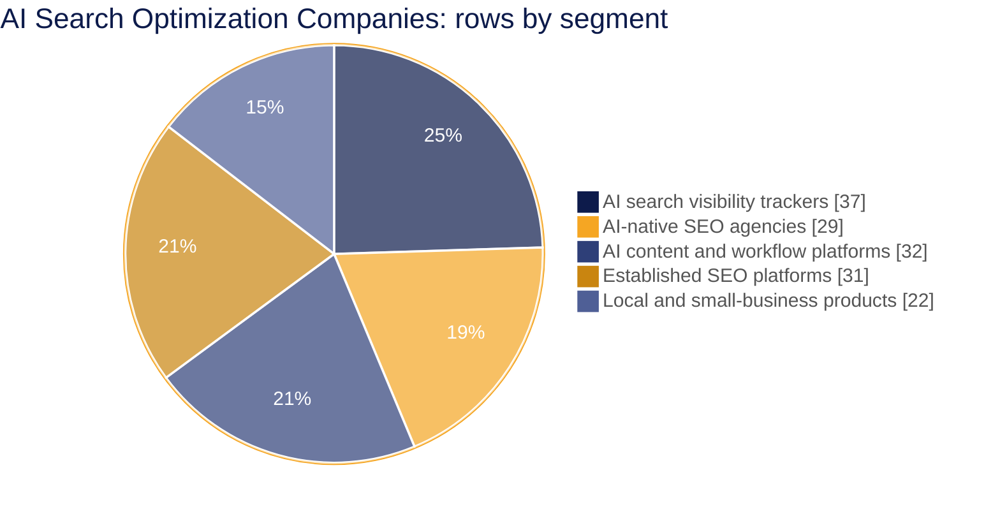
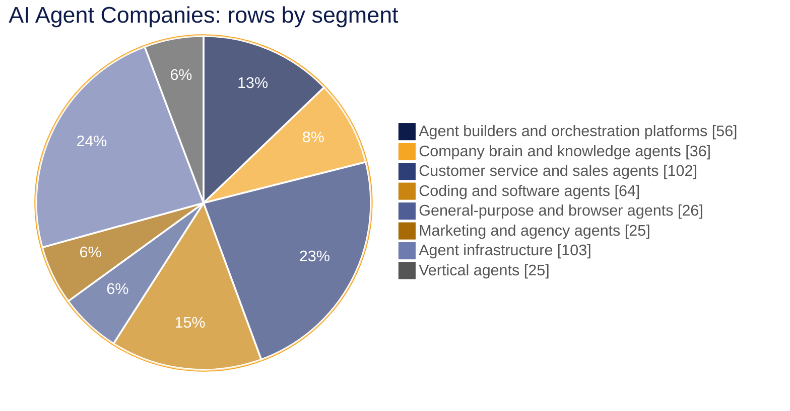
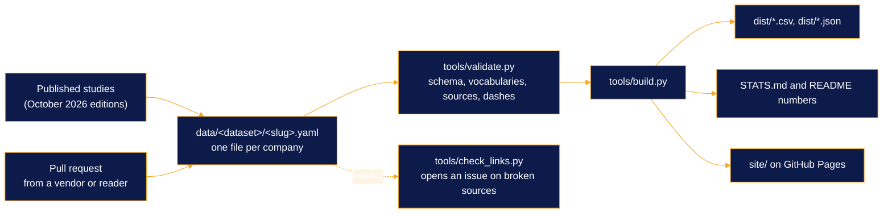

<p align="center">
  
</p>

<h3 align="center">The open, sourced dataset of who sells AI search optimization and AI agents.<br>One YAML file per company, a source URL for every number, CC BY 4.0.</h3>

<p align="center">
  <a href="https://github.com/chris-fountoulis/ai-search-landscape/actions/workflows/ci.yml"></a>
  <a href="https://github.com/chris-fountoulis/ai-search-landscape/releases"></a>
  <a href="LICENSE-DATA"></a>
  <a href="LICENSE"></a>
  <a href="#quickstart-30-seconds"></a>
</p>

<p align="center">
  <a href="https://growthofinfluence.com/"></a>
  <a href="https://chrisfountoulis.com"></a>
</p>

<p align="center">
  <a href="https://chris-fountoulis.github.io/ai-search-landscape/"></a>
</p>

<p align="center">
  <a href="https://chris-fountoulis.github.io/ai-search-landscape/"><b>Live site</b></a> ·
  <a href="#headline-numbers">Numbers</a> ·
  <a href="#quickstart-30-seconds">Quickstart</a> ·
  <a href="#use-the-data">Download</a> ·
  <a href="#methodology">Methodology</a> ·
  <a href="#contributing">Add or correct a company</a> ·
  <a href="#cite-this-dataset">Cite</a>
</p>

---

This is the structured dataset behind two data studies published by [Growth Of Influence](https://growthofinfluence.com/). It was built by [Chris Fountoulis](https://chrisfountoulis.com) and the research team at Growth Of Influence, and every row can be corrected by pull request.

| Study | What it covers | Rows |
|---|---|---:|
| **[AI Search Optimization Companies](https://growthofinfluence.com/ai-search-optimization-companies/)** | AI visibility tracking, generative engine optimization (GEO), answer engine optimization (AEO), AI content for search and the established SEO platforms they compete with | 151 companies |
| **[AI Agent Companies](https://growthofinfluence.com/ai-agent-companies/)** | Agent builders, coding agents, customer service agents, company brain agents, agent infrastructure and vertical agents | 437 products from 420 companies |

> [!NOTE]
> No sourced, structured dataset of GEO and AEO vendors existed in public before this one. A blank field here means *not disclosed or not verified*. It never means zero.

<p align="center">
  
</p>

<details>
<summary><b>The same check in plain text</b> (what CI runs on every pull request)</summary>

```console
$ python3 tools/validate.py
OK: 588 record(s) valid.
$ python3 tools/build.py --check
OK: 7 generated file(s) are up to date.
$ python3 -m unittest discover -s tests -t .
Ran 50 tests in 2.4s
OK
```

</details>

## Contents

- [Headline numbers](#headline-numbers)
- [Quickstart (30 seconds)](#quickstart-30-seconds)
- [Use the data](#use-the-data)
- [Why this exists](#why-this-exists)
- [How it works](#how-it-works)
- [Methodology](#methodology)
- [Contributing](#contributing)
- [Roadmap](#roadmap)
- [Cite this dataset](#cite-this-dataset)
- [License](#license)

## Headline numbers

<!-- stats:start (generated by tools/build.py, do not edit by hand) -->

| | AI search optimization | AI agents |
|---|---:|---:|
| Rows | 151 | 437 |
| Companies | 151 | 420 |
| Countries | 28 | 28 |
| Disclosed equity funding (minimum) | $2.59B | $40.28B |
| Acquired | 16 | 33 |
| Founded 2023 or later (of known) | 25 of 70 | 131 of 299 |
| Last verified | 2026-10-30 | 2026-10-30 |

Agent funding excludes the frontier model labs, as in the published study. Full breakdowns: [STATS.md](STATS.md).





<!-- stats:end -->

## Quickstart (30 seconds)

Load a dataset straight from GitHub. You do not need to clone anything:

```bash
# Every AI search vendor headquartered in Germany
curl -s https://raw.githubusercontent.com/chris-fountoulis/ai-search-landscape/main/dist/landscape.json \
  | jq -r '.records[] | select(.dataset == "ai-search" and .hq.country == "DE") | .name'
```

```python
# Disclosed funding by AI agent segment, each company counted once per segment (pandas)
import pandas as pd
df = pd.read_csv("https://raw.githubusercontent.com/chris-fountoulis/ai-search-landscape/main/dist/ai-agents.csv")
funded = df[~df.model_lab].drop_duplicates(["segment_label", "company"])
print(funded.groupby("segment_label").funding_total_usd.sum().div(1e9).round(2).sort_values())
```

Or clone it and run the same checks CI runs (Python 3.9 or newer, standard library only):

```console
$ git clone https://github.com/chris-fountoulis/ai-search-landscape && cd ai-search-landscape
$ python3 tools/validate.py
OK: 588 record(s) valid.
$ python3 tools/build.py --check
OK: 7 generated file(s) are up to date.
$ python3 -m unittest discover -s tests -t .
Ran 50 tests in 2.4s
OK
```

> [!TIP]
> Prefer a table you can search? The [live site](https://chris-fountoulis.github.io/ai-search-landscape/) loads the same `dist/landscape.json` with search, filters, sortable columns and a link from every row to its YAML file.

## Use the data

| File | What it is |
|---|---|
| [`dist/ai-search.csv`](https://raw.githubusercontent.com/chris-fountoulis/ai-search-landscape/main/dist/ai-search.csv) | AI search optimization companies, one row per company, flat columns |
| [`dist/ai-agents.csv`](https://raw.githubusercontent.com/chris-fountoulis/ai-search-landscape/main/dist/ai-agents.csv) | AI agent products, one row per product, flat columns |
| [`dist/ai-search.json`](https://raw.githubusercontent.com/chris-fountoulis/ai-search-landscape/main/dist/ai-search.json), [`dist/ai-agents.json`](https://raw.githubusercontent.com/chris-fountoulis/ai-search-landscape/main/dist/ai-agents.json) | The same records, nested exactly as in the YAML files, with dataset metadata |
| [`dist/landscape.json`](https://raw.githubusercontent.com/chris-fountoulis/ai-search-landscape/main/dist/landscape.json) | Both datasets plus the segment, country, status and pricing model labels |
| [`data/<dataset>/<slug>.yaml`](data/) | The source of truth: one human-editable file per company |
| [`STATS.md`](STATS.md) | Counts by segment, region, country and founding year |

Every CSV row ends with `yaml_url`, a link to the record on GitHub. The flat columns are documented in [`schema/company.schema.json`](schema/company.schema.json). Multi-value `sources` are joined with ` | `.

<details>
<summary><b>What a record looks like</b></summary>

```yaml
name: "Profound"
slug: "profound"
dataset: "ai-search"
company: "Profound"
website: "tryprofound.com"
segment: "geo-tracking"
hq:
  city: "New York"
  country: "US"
founded:
  year: 2024
  source: "https://www.tryprofound.com/newsroom/profound-raises-usd180m-series-d-at-usd1-8b-valuation-to-build-the-ai-platform-for-marketing-teams"
status: "active"
funding:
  total_usd: 335000000
  latest_round:
    name: "Series D"
    date: "2026-09"
    amount_usd: 180000000
    valuation_usd: 1800000000
  source: "https://www.tryprofound.com/newsroom/profound-raises-usd180m-series-d-at-usd1-8b-valuation-to-build-the-ai-platform-for-marketing-teams"
pricing:
  as_listed_by_vendor: "custom (free trial; Enterprise and Agency Growth sales-only)"
  source: "https://www.tryprofound.com/pricing"
sources:
  - "https://www.tryprofound.com/newsroom/profound-raises-usd180m-series-d-at-usd1-8b-valuation-to-build-the-ai-platform-for-marketing-teams"
  - "https://pulse2.com/profound-raises-180-million-series-d-at-1-8-billion-valuation-to-build-ai-platform-for-marketing-teams/"
  - "https://www.fortune.com/2026/02/24/exclusive-as-ai-threatens-search-profound-raises-96-million-to-help-brands-stay-visible"
  - "https://www.tryprofound.com/pricing"
last_verified: "2026-10-26"
```

</details>

> [!IMPORTANT]
> **Reading the data correctly**
> * A missing field means *not disclosed or not verified*, never zero.
> * Funding is disclosed equity in US dollars and is a **minimum**. Public companies carry no funding total. Count funding once per `company`, not per row: one company can have several product rows.
> * Frontier model labs are flagged `model_lab: true` and are left out of every total here, as in the study.
> * Prices are monthly list prices **as listed by the vendor** on its own site, before tax, on the `last_verified` date.

## Why this exists

We run SEO, AEO and AI content work for clients at [Growth Of Influence](https://growthofinfluence.com/). "Which AI search tool should we use and who is behind it?" is a question we answer every week. In October 2026 we published two market maps to answer it properly: every company checked against its own site, its filings and named press, with blanks instead of guesses.

Within a day companies started writing in with corrections. One had its legal seat in another country. One had a different founding year. A bootstrapped company was listed with unknown funding. Email does not scale for that and a table inside a blog post cannot be diffed, cited by version or reused. So the data now lives here: one reviewable file per company, a validator that refuses a number without a source and a public history of every change.

## How it works



| Tool | What it does |
|---|---|
| `tools/yamlite.py` | A strict, dependency-free loader for the small YAML subset the data uses. It refuses YAML's implicit typing traps (`no` becoming false, `2026-10` becoming a date) instead of guessing. |
| `tools/validate.py` | JSON Schema checks (`tools/schemalite.py`), controlled vocabularies in [`schema/vocab/`](schema/vocab/) (segments, ISO 3166-1 countries, statuses, pricing models), slug and name uniqueness, URL format, a listed source for every number, status consistency, a ban on en and em dashes and canonical formatting. |
| `tools/build.py` | Deterministic CSV and JSON outputs, `STATS.md` and the numbers block in this README. CI fails a pull request whose generated files are stale. |
| `tools/check_links.py` | A rate-limited HEAD-then-GET checker with a browser User-Agent. A weekly workflow runs it and opens one issue listing broken links. It never runs on pull requests. |
| `site/` | One HTML file with vanilla JavaScript: search, filters, sortable columns and a link from every row to its YAML. Published to [GitHub Pages](https://chris-fountoulis.github.io/ai-search-landscape/). |

Zero third-party Python packages. The tools run on a stock Python 3.9 to 3.13 and CI tests both ends of that range.

## Methodology

The full rules are in **[METHODOLOGY.md](METHODOLOGY.md)**. They are adapted from the methodology sections of the [AI search study](https://growthofinfluence.com/ai-search-optimization-companies/) and the [AI agent study](https://growthofinfluence.com/ai-agent-companies/). In short:

| Rule | What it means in the data |
|---|---|
| **Inclusion rubric** | An AI search row sells something whose main purpose includes getting brands found in search and markets an AI search feature, or is a major SEO platform buyers compare against. An AI agent row markets a product that plans and takes multi-step actions in other systems, is available now and passes a notability floor: at least one dated, independent source. Custom agent development shops are out. |
| **HQ is the legal seat** | Headquarters is the legal seat in the company's own Terms, Imprint or Legal Notice. A state of incorporation alone, a registered agent or a mail-forwarding address does not count. |
| **Every number has a source** | Founded year, funding, rounds, valuations, acquisitions and prices each carry their own `source` URL. A figure without one was dropped and the company kept. No estimates. Data aggregators were leads, never sources. |
| **Quarterly refresh** | Both studies are refreshed in January, April, July and October at the same URLs. |
| **Corrections** | Any correction with a public source is reviewed within five working days, merged as a pull request and listed in [`CHANGELOG.md`](CHANGELOG.md). |

### Source audit, 2026-10-30

Before the repository went public every figure-level `source` link was audited so that it points at a page that actually states its figure. That covered **2,312 figures in 588 rows**. About 2,500 pages were fetched and a script checked each figure against the page text. About 280 figures it could not confirm were researched by hand, each backed by a verbatim quote.

| Figures | Count | Page text states it (script) | Stated, confirmed by hand | Sum of sourced rounds | Not confirmed |
|---|---:|---:|---:|---:|---:|
| Funding totals, rounds, valuations | 722 | 633 | 42 | 47 | 0 |
| Founded years | 369 | 327 | 42 | | 0 |
| Acquisitions | 57 | 55 | 2 | | 0 |
| Headquarters | 569 (37 with a country only) | 477 | 24 | | 31 |
| Prices | 564 | 286 | 247 (vendor pricing or contact-sales page for "custom") | | 31 |

The audit re-pointed or added 1,057 sources, corrected 42 values and removed 36 (the company always stays). Every funding, founded-year and acquisition figure now rests on a page that states it.

> [!WARNING]
> **Known limits.** The 31 headquarters without a `hq.source` are mostly product lines of large public companies. The 31 unconfirmed prices sit on vendor pages that render prices only in a browser and are queued for a hand check. Because of the audit's corrections the funding totals here differ slightly from the figures published in the two studies on 26 and 29 October 2026. The datasets are not a census of every product in either market.

## Contributing

Corrections and additions are welcome, including from the companies listed. Every change needs a public source and is reviewed within five working days.

| You want to | Open |
|---|---|
| Add a company | [Add a company](https://github.com/chris-fountoulis/ai-search-landscape/issues/new?template=add-company.yml) |
| Fix a field | [Correct a company](https://github.com/chris-fountoulis/ai-search-landscape/issues/new?template=correct-company.yml) |
| Report a closure or acquisition | [Company closed or acquired](https://github.com/chris-fountoulis/ai-search-landscape/issues/new?template=company-closed.yml) |

The inclusion rubric, the editing guide and the local checks are in [CONTRIBUTING.md](CONTRIBUTING.md). Every field rule is in [METHODOLOGY.md](METHODOLOGY.md).

## Roadmap

- [ ] **January 2027 edition** of both studies, refreshed at the same URLs, including the 136 AI agent candidates deferred from October for their notability check.
- [ ] **Legal-seat recheck** of every AI search HQ, now that both studies use the same HQ rule.
- [ ] **Revenue fields**, published only with a per-figure source, basis (filed, company-stated or reported) and scope note.
- [ ] **Price source review**: confirm by hand the listed prices whose pricing pages render only in a browser (see the [source audit](#source-audit-2026-10-30)).

## Cite this dataset

> Fountoulis, C. and Growth Of Influence (2026). *AI Search Landscape: an open, sourced dataset of AI search optimization and AI agent companies* (version 0.2.0). https://github.com/chris-fountoulis/ai-search-landscape

Machine-readable metadata is in [`CITATION.cff`](CITATION.cff), so GitHub shows a "Cite this repository" button. When you use the numbers, link the repository or the study you used.

## License

| Part | License |
|---|---|
| **Data** (`data/`, `dist/`, `STATS.md`) | [CC BY 4.0](LICENSE-DATA). Credit "Growth Of Influence, AI Search Landscape" with a link. |
| **Code** (`tools/`, `tests/`, `site/`, `schema/`, workflows) | [MIT](LICENSE) |

The data is compiled from public sources as of the dates in each record and is provided as is. It is not investment, legal or purchasing advice. Company names and trademarks belong to their owners and are used only to identify them. Growth Of Influence sells SEO, content and AI services and competes with some companies listed. It is not in either dataset and no company paid to be included.

---

<p align="center">
  
</p>

<p align="center">
  Built by <a href="https://chrisfountoulis.com">Chris Fountoulis</a> at <a href="https://growthofinfluence.com/">Growth Of Influence</a>, Thessaloniki.<br>
  <a href="https://growthofinfluence.com/ai-search-optimization-companies/">AI Search Optimization Companies</a> · <a href="https://growthofinfluence.com/ai-agent-companies/">AI Agent Companies</a> · <a href="https://chris-fountoulis.github.io/ai-search-landscape/">Live dataset</a> · <a href="https://growthofinfluence.com/meeting">Talk to the team</a>
</p>
