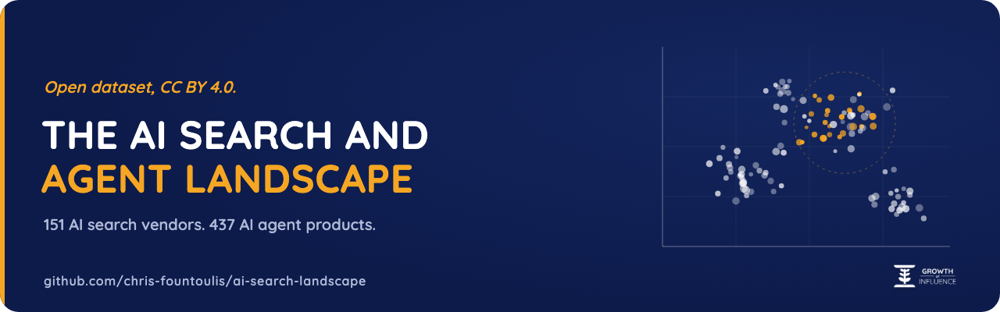
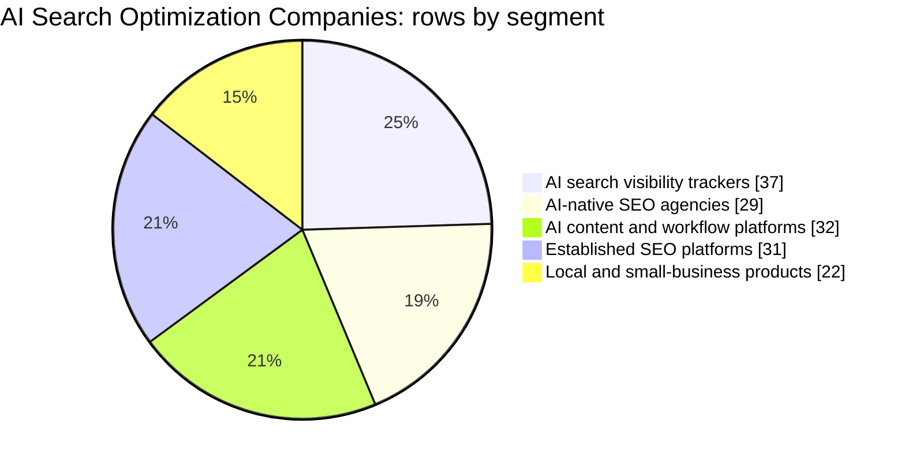
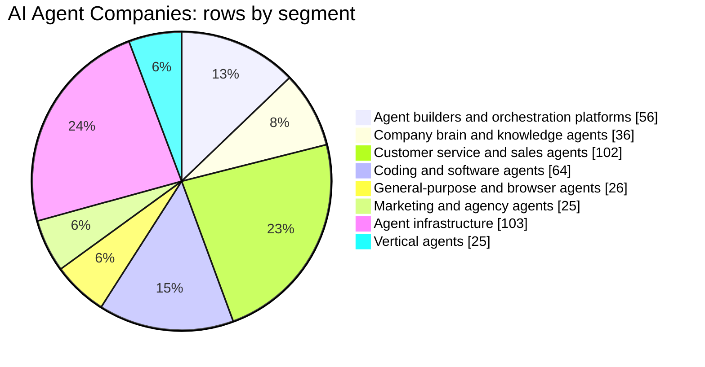
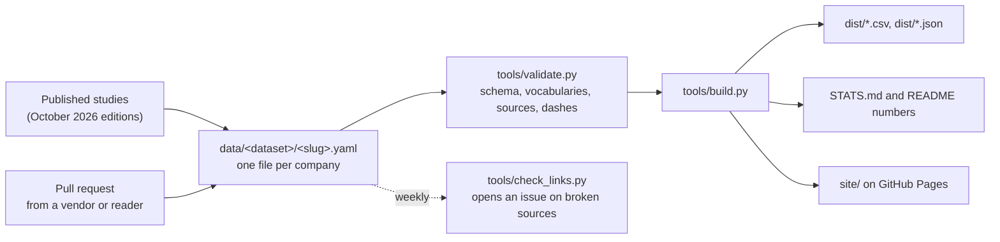

<p align="center">
  
</p>

<h3 align="center">The open, sourced dataset of who sells AI search optimization and AI agents.<br>One YAML file per company, a source URL for every number, CC BY 4.0.</h3>

<p align="center">
  <a href="https://github.com/chris-fountoulis/ai-search-landscape/actions/workflows/ci.yml"></a>
  <a href="LICENSE-DATA"></a>
  <a href="LICENSE"></a>
  <a href="https://github.com/chris-fountoulis/ai-search-landscape/tags"></a>
  <a href="https://chris-fountoulis.github.io/ai-search-landscape/"></a>
</p>

<p align="center">
  <a href="https://chris-fountoulis.github.io/ai-search-landscape/"><b>Browse the data</b></a> ·
  <a href="#use-the-data">Download CSV or JSON</a> ·
  <a href="https://growthofinfluence.com/ai-search-optimization-companies/">AI search study</a> ·
  <a href="https://growthofinfluence.com/ai-agent-companies/">AI agent study</a> ·
  <a href="CONTRIBUTING.md">Add or correct a company</a>
</p>

---

This is the structured dataset behind two published data studies by [Growth Of Influence](https://growthofinfluence.com/):

* **[AI Search Optimization Companies](https://growthofinfluence.com/ai-search-optimization-companies/)**: 151 vendors of AI visibility tracking, generative engine optimization (GEO), answer engine optimization (AEO), AI content for search, and the established SEO platforms they compete with.
* **[AI Agent Companies](https://growthofinfluence.com/ai-agent-companies/)**: 437 AI agent products from 420 companies, from agent builders and coding agents to customer service agents and agent infrastructure.

No sourced, structured dataset of GEO and AEO vendors existed publicly. This one is open, versioned and correctable by pull request.

## Headline numbers

<!-- stats:start (generated by tools/build.py, do not edit by hand) -->

| | AI search optimization | AI agents |
|---|---:|---:|
| Rows | 151 | 437 |
| Companies | 151 | 420 |
| Countries | 28 | 28 |
| Disclosed equity funding (minimum) | $2.59B | $40.28B |
| Acquired | 16 | 33 |
| Founded 2023 or later (of known) | 25 of 70 | 131 of 299 |
| Last verified | 2026-10-30 | 2026-10-30 |

Agent funding excludes the frontier model labs, as in the published study. Full breakdowns: [STATS.md](STATS.md).





<!-- stats:end -->

## Quickstart (30 seconds)

Load a dataset straight from GitHub, no clone needed:

```bash
# Every AI search vendor headquartered in Germany
curl -s https://raw.githubusercontent.com/chris-fountoulis/ai-search-landscape/main/dist/landscape.json \
  | jq -r '.records[] | select(.dataset == "ai-search" and .hq.country == "DE") | .name'
```

```python
# Disclosed funding by AI agent segment, each company counted once per segment (pandas)
import pandas as pd
df = pd.read_csv("https://raw.githubusercontent.com/chris-fountoulis/ai-search-landscape/main/dist/ai-agents.csv")
funded = df[~df.model_lab].drop_duplicates(["segment_label", "company"])
print(funded.groupby("segment_label").funding_total_usd.sum().div(1e9).round(2).sort_values())
```

Or clone it and run the same checks CI runs (Python 3.9 or newer, standard library only):

```console
$ git clone https://github.com/chris-fountoulis/ai-search-landscape && cd ai-search-landscape
$ python3 tools/validate.py
OK: 588 record(s) valid.
$ python3 tools/build.py --check
OK: 7 generated file(s) are up to date.
$ python3 -m unittest discover -s tests -t .
Ran 50 tests in 2.4s
OK
```

## Use the data

| File | What it is |
|---|---|
| [`dist/ai-search.csv`](https://raw.githubusercontent.com/chris-fountoulis/ai-search-landscape/main/dist/ai-search.csv) | AI search optimization companies, one row per company, flat columns |
| [`dist/ai-agents.csv`](https://raw.githubusercontent.com/chris-fountoulis/ai-search-landscape/main/dist/ai-agents.csv) | AI agent products, one row per product, flat columns |
| [`dist/ai-search.json`](https://raw.githubusercontent.com/chris-fountoulis/ai-search-landscape/main/dist/ai-search.json), [`dist/ai-agents.json`](https://raw.githubusercontent.com/chris-fountoulis/ai-search-landscape/main/dist/ai-agents.json) | The same records, nested exactly as in the YAML files, with dataset metadata |
| [`dist/landscape.json`](https://raw.githubusercontent.com/chris-fountoulis/ai-search-landscape/main/dist/landscape.json) | Both datasets plus the segment, country, status and pricing model labels |
| [`data/<dataset>/<slug>.yaml`](data/) | The source of truth: one human-editable file per company |
| [`STATS.md`](STATS.md) | Counts by segment, region, country and founding year |

Every CSV row ends with `yaml_url`, a link to the record on GitHub. The flat columns are documented in [`schema/company.schema.json`](schema/company.schema.json); multi-value `sources` are joined with ` | `.

A record looks like this:

```yaml
name: "Profound"
slug: "profound"
dataset: "ai-search"
company: "Profound"
website: "tryprofound.com"
segment: "geo-tracking"
hq:
  city: "New York"
  country: "US"
founded:
  year: 2024
  source: "https://www.tryprofound.com/newsroom/profound-raises-usd180m-series-d-at-usd1-8b-valuation-to-build-the-ai-platform-for-marketing-teams"
status: "active"
funding:
  total_usd: 335000000
  latest_round:
    name: "Series D"
    date: "2026-09"
    amount_usd: 180000000
    valuation_usd: 1800000000
  source: "https://www.tryprofound.com/newsroom/profound-raises-usd180m-series-d-at-usd1-8b-valuation-to-build-the-ai-platform-for-marketing-teams"
pricing:
  as_listed_by_vendor: "custom (free trial; Enterprise and Agency Growth sales-only)"
  source: "https://www.tryprofound.com/pricing"
sources:
  - "https://www.tryprofound.com/newsroom/profound-raises-usd180m-series-d-at-usd1-8b-valuation-to-build-the-ai-platform-for-marketing-teams"
  - "https://pulse2.com/profound-raises-180-million-series-d-at-1-8-billion-valuation-to-build-ai-platform-for-marketing-teams/"
  - "https://www.fortune.com/2026/02/24/exclusive-as-ai-threatens-search-profound-raises-96-million-to-help-brands-stay-visible"
  - "https://www.tryprofound.com/pricing"
last_verified: "2026-10-26"
```

**Reading the data correctly**

* A missing field means *not disclosed or not verified*, never zero.
* Funding is disclosed equity in US dollars and is a **minimum**. Public companies carry no funding total. Count funding once per `company`, not per row: one company can have several product rows.
* Frontier model labs are flagged `model_lab: true` and are left out of every total here, as in the study.
* Prices are monthly list prices **as listed by the vendor** on its own site, before tax, on the `last_verified` date.

## Why this exists

At Growth Of Influence we run SEO, AEO and AI content work for clients, so "which AI search tool should we use, and who is behind it?" is a question we answer every week. In October 2026 we published two market maps to answer it properly: every company checked against its own site, its filings and named press, with blanks instead of guesses.

Within a day of publishing, companies started writing in with corrections: a legal seat in another country, a founding year, a bootstrapped company listed with unknown funding. Email does not scale for that, and a table inside a blog post cannot be diffed, cited by version or reused. So the data now lives here: one reviewable file per company, a validator that refuses a number without a source, and a public history of every change.

## How it works



* **`tools/yamlite.py`**: a strict, dependency-free loader for the small YAML subset the data uses. It refuses YAML's implicit typing traps (`no` becoming false, `2026-10` becoming a date) instead of guessing.
* **`tools/validate.py`**: JSON Schema checks (`tools/schemalite.py`), controlled vocabularies in [`schema/vocab/`](schema/vocab/) (segments, ISO 3166-1 countries, statuses, pricing models), slug and name uniqueness, URL format, a listed source for every number, status consistency, a ban on en and em dashes, and canonical formatting.
* **`tools/build.py`**: deterministic CSV and JSON outputs, `STATS.md`, and the numbers block in this README. CI fails a pull request whose generated files are stale.
* **`tools/check_links.py`**: a rate-limited HEAD-then-GET checker with a browser User-Agent. A weekly workflow runs it and opens one issue listing broken links. It never runs on pull requests.
* **`site/`**: one HTML file with vanilla JavaScript: search, filters, sortable columns and a link from every row to its YAML.

Zero third-party Python packages: the tools run on a stock Python 3.9 to 3.13.

## Contributing

Corrections and additions are welcome, including from the companies listed. Every change needs a public source, and is reviewed within five working days.

* [Add a company](https://github.com/chris-fountoulis/ai-search-landscape/issues/new?template=add-company.yml)
* [Correct a company](https://github.com/chris-fountoulis/ai-search-landscape/issues/new?template=correct-company.yml)
* [Report a closure or acquisition](https://github.com/chris-fountoulis/ai-search-landscape/issues/new?template=company-closed.yml)

The inclusion rubric (real AI search or agent product, notability floor, development shops out, HQ is the legal seat) is in [CONTRIBUTING.md](CONTRIBUTING.md), and every field rule is in [METHODOLOGY.md](METHODOLOGY.md).

## Roadmap

* **January 2027 edition** of both studies, refreshed at the same URLs, including the 136 AI agent candidates deferred from October for their notability check.
* **Legal-seat recheck** of every AI search HQ, now that both studies use the same HQ rule.
* **Revenue fields**, published only with a per-figure source, basis (filed, company-stated or reported) and scope note.
* **Price source review**: confirm by hand the listed prices whose pricing pages render only in a browser (see the source audit in METHODOLOGY.md).

## Cite this dataset

> Fountoulis, C. and Growth Of Influence (2026). *AI Search Landscape: an open, sourced dataset of AI search optimization and AI agent companies* (version 0.2.0). https://github.com/chris-fountoulis/ai-search-landscape

Machine-readable metadata is in [`CITATION.cff`](CITATION.cff) (GitHub shows a "Cite this repository" button). When you use the numbers, link the repository or the study you used.

## License

* **Data** (`data/`, `dist/`, `STATS.md`): [CC BY 4.0](LICENSE-DATA). Credit "Growth Of Influence, AI Search Landscape" with a link.
* **Code** (`tools/`, `tests/`, `site/`, `schema/`, workflows): [MIT](LICENSE).

The data is compiled from public sources as of the dates in each record and is provided as is. It is not investment, legal or purchasing advice. Company names and trademarks belong to their owners and are used only to identify them. Growth Of Influence sells SEO, content and AI services and competes with some companies listed; it is not in either dataset, and no company paid to be included.

---

<p align="center">
  Built by <a href="https://www.linkedin.com/in/chrisfountoulis/">Chris Fountoulis</a> at <a href="https://growthofinfluence.com/">Growth Of Influence</a>, Thessaloniki.<br>
  <a href="https://growthofinfluence.com/ai-search-optimization-companies/">AI Search Optimization Companies</a> · <a href="https://growthofinfluence.com/ai-agent-companies/">AI Agent Companies</a>
</p>
